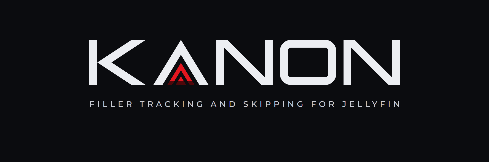
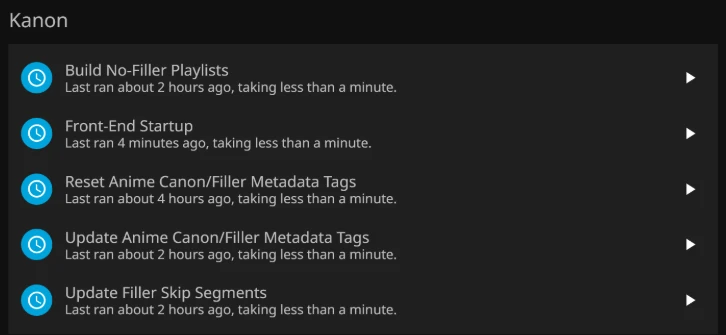
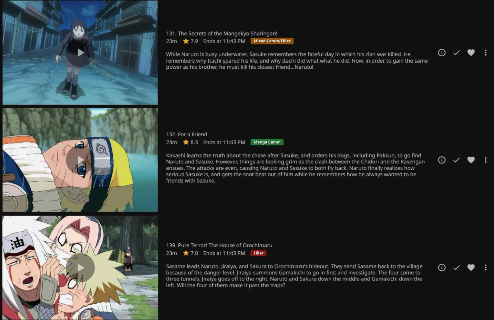
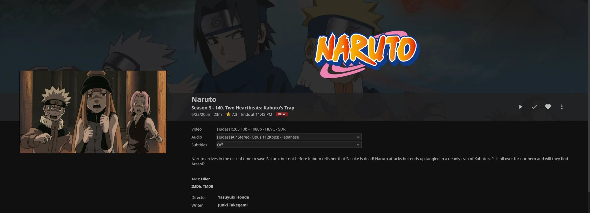
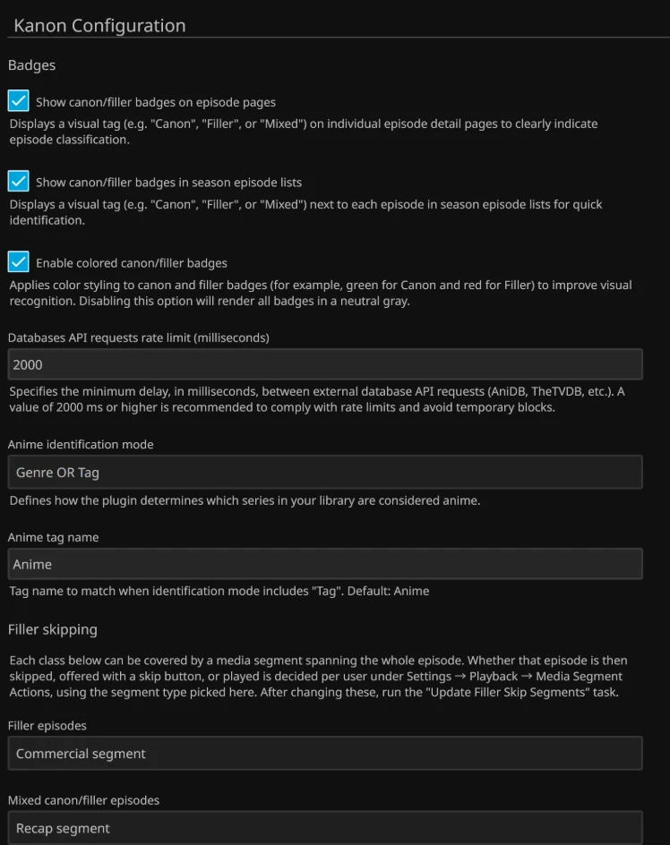

# Kanon: Filler Tracking and Skipping for Jellyfin



Kanon marks anime episodes as **Manga Canon**, **Anime Canon**, **Mixed Canon/Filler** or **Filler**, and can skip filler for you. Filler is skipped either automatically in the normal player, through Jellyfin's Media Segment Actions, or by playing a no-filler playlist.

Kanon is a fork of [Ronin](https://github.com/ahza-code/jellyfin-plugin-ronin) by [ahza-code](https://github.com/ahza-code). See [Changes from Ronin](#changes-from-ronin).

## Requirements

- Jellyfin `12.4` or newer.
- An anime library that has been scanned. It can use TMDB (the default), TheTVDB or AniDB metadata.
- Optional: [File Transformation](https://github.com/IAmParadox27/jellyfin-plugin-file-transformation) by [IAmParadox27](https://github.com/IAmParadox27). It is only needed for the coloured badges in the web client. Tagging, skipping and playlists work without it.

## Installation

1. Add this manifest URL under Dashboard → Plugins → Repositories:
   ```text
   https://raw.githubusercontent.com/DrLatBC/jellyfin-plugin-kanon/main/manifest.json
   ```
2. Install **Kanon** from the Catalog.
3. Restart Jellyfin.

## Getting started

Run these from Dashboard → Scheduled Tasks → Kanon, in this order:

1. **Update Anime Canon/Filler Metadata Tags.** This looks up every anime series on [Anime Filler List](https://www.animefillerlist.com) and tags each episode.
2. **Update Filler Skip Segments.** This adds the skip segments, explained below.
3. **Build No-Filler Playlists.** Optional.



## Features

### Canon and filler tags

Each episode gets one tag: `Manga Canon`, `Anime Canon`, `Mixed Canon/Filler` or `Filler`. Tags are ordinary Jellyfin tags, so you can filter on them anywhere. If File Transformation is installed, they also show as badges on episode pages and in season lists.





To match an episode to Anime Filler List, Kanon needs its absolute episode number. It uses TheTVDB or AniDB when the series has those IDs. Otherwise it reads the library's own numbering: TMDB numbers long anime continuously (Naruto season 2 starts at episode 53), and seasons that restart at 1 are added up.

### Skipping filler in the normal player

Kanon is a media segment provider, just like intro skippers. It covers each filler episode with one segment that runs from start to end. Each user chooses what happens to it under **Settings → Playback → Media Segment Actions**:

- **Skip**: the player jumps to the end and autoplay moves on to the next episode.
- **Ask to skip**: a skip button appears when the episode starts.
- **None**: the episode plays normally.

In Kanon's settings, choose which segment type covers each class of episode:

| Episode class | Default |
|---|---|
| Filler | Commercial |
| Mixed Canon/Filler | not marked |
| Anime Canon | not marked |

Give mixed episodes a different type, such as Recap, to act on them separately (for example: skip filler, ask on mixed). Run **Update Filler Skip Segments** again after changing these settings. Segments from other providers, such as intros and credits, are never touched.

Skipping works in any Jellyfin client that supports media segments.

In the web client, and the phone apps built on it, Kanon also takes episodes set to **Skip** out of the play queue when playback starts. Long runs of filler are then passed over entirely instead of each one loading and skipping in turn. This needs File Transformation.



### No-filler playlists

**Build No-Filler Playlists** creates a public playlist for each tagged series, for example `Naruto (No Filler)`. It contains every episode except filler, in order. Turn on **Leave mixed canon/filler episodes out of playlists** to leave mixed episodes out too. Re-running it rebuilds the playlists.

### Anime identification

Kanon only processes series it identifies as anime. There are four identification modes:

- **Genre or Tag** (default): the series has an `Anime` genre or the target tag. TMDB files anime under "Animation", but adds an `anime` keyword tag, so TMDB libraries work without any setup.
- **Genre**: only series with an `Anime` genre.
- **Tag**: only series with the target tag (default `Anime`, case-insensitive). This is useful for limiting Kanon to particular shows.
- **Genre and Tag**: the series needs both.

**Anime libraries:** tick one or more libraries in Kanon's settings, and every series in them counts as anime, whatever its genres and tags. This suits libraries matched by Shoko, AniDB or similar providers, which rarely label anime with an "Anime" genre or tag. Series outside the ticked libraries are still matched by the mode above.

Kanon never moves, renames or re-seasons episodes. It only adds tags, skip segments and playlists.

## Changes from Ronin

- Builds against Jellyfin 12.4 and .NET 10.
- Filler skipping through media segments, with a segment type setting for each episode class.
- No-filler playlists.
- Absolute episode numbers from the library's own numbering, so TMDB libraries work without TheTVDB or AniDB.
- Anime identification defaults to Genre or Tag, so TMDB libraries are found.
- Whole libraries can be marked as anime ([Ronin #5](https://github.com/ahza-code/jellyfin-plugin-ronin/issues/5)).
- Ronin's season re-organisation tasks (Aired Seasons and Force Single Season) are removed. Kanon leaves the library layout alone.
- Renamed, with a new plugin ID, so it installs alongside or instead of Ronin without conflicts.

## Releasing

Push an annotated tag with a four-part version:

```bash
git tag -a v1.0.0.0 -m "What changed in this release"
git push origin v1.0.0.0
```

The Release workflow then:
1. builds the plugin;
2. attaches `kanon_<version>.zip` to a GitHub release, using the tag message as the release notes;
3. adds the version to `manifest.json` with its checksum and target Jellyfin version, which it reads from the `Jellyfin.Controller` package version.

## License

Kanon is licensed under the **GNU General Public License v3.0**, the same licence as Ronin. See [LICENSE](LICENSE).

Original work: Copyright (c) ahza-code, [Ronin](https://github.com/ahza-code/jellyfin-plugin-ronin).
Modifications: Copyright (c) DrLatBC.

Filler data comes from [Anime Filler List](https://www.animefillerlist.com).
